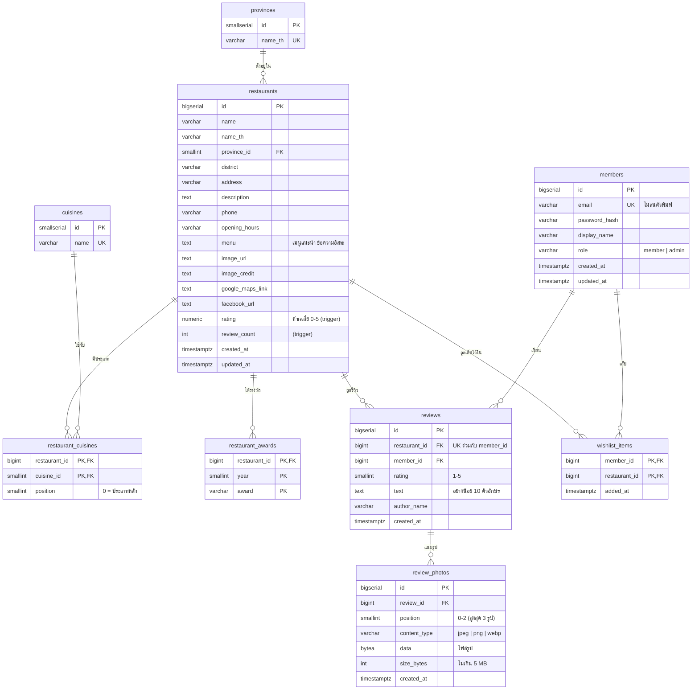

# foodjubb.com Database Schema (ส่งให้ทีม Go)

| ไฟล์ | ใช้ทำอะไร |
|---|---|
| [`db/schema.sql`](db/schema.sql) | สร้างตารางทั้งหมด (PostgreSQL 14+) พร้อม index, trigger คำนวณคะแนน และ seed จังหวัด 77 จังหวัด + ประเภทอาหาร 21 ประเภท รันครั้งเดียว |
| `seed.sql` (ในโปรเจกต์ backend) | ร้านอาหาร 100 ร้านจาก `data/restaurants_100.csv` + บัญชีทดลอง สร้างด้วย `scripts/make_seed.py` |
| [`restaurant-api-spec.md`](restaurant-api-spec.md) | สัญญา API ที่หน้าเว็บเรียก (ชื่อ field แบบ camelCase) |

```bash
psql "$DATABASE_URL" -f schema.sql
psql "$DATABASE_URL" -f seed.sql
```

## 1. ภาพรวมตาราง



ผู้ใช้ 3 แบบ (Guest / Member / Admin) ไม่มีตารางของ Guest เพราะ Guest คือคนที่ไม่ได้ login ส่วน Member กับ Admin ใช้ตาราง `members` ตัวเดียวกัน แยกกันด้วยคอลัมน์ `role`

## 2. คำอธิบายแต่ละตาราง

| ตาราง | หน้าที่ | หมายเหตุ |
|---|---|---|
| `provinces` | จังหวัดทั้ง 77 จังหวัด ใช้กรองหน้าเว็บ | seed แล้วใน schema.sql ฟอร์มหลังบ้านเลือกจาก dropdown ตรงกับค่าคงที่ `PROVINCES` ใน `src/data/data.js` |
| `cuisines` | ประเภทอาหาร (ไทย กาแฟ ของหวาน ...) 21 ประเภทตั้งต้น | ฟอร์มหลังบ้านพิมพ์ประเภทใหม่ได้ ถ้าชื่อยังไม่มีให้ backend `INSERT ... ON CONFLICT (name) DO NOTHING` แล้วใช้ id นั้น |
| `members` | บัญชีผู้ใช้ | เก็บ `password_hash` (bcrypt) ไม่เก็บรหัสผ่านตรง ๆ อีเมลซ้ำไม่ได้ (ตอบ 409) |
| `restaurants` | ร้านอาหาร | `rating` กับ `review_count` ถูก trigger อัปเดตจาก `reviews` ไม่ต้องให้ Go คำนวณเอง **ไม่มีระดับราคา** `image_url` ใช้ `text` เพราะลิงก์รูปจาก CDN ยาวได้เป็นพันตัวอักษร |
| `restaurant_cuisines` | ร้านหนึ่งมีได้หลายประเภท (many-to-many) | `position = 0` คือประเภทหลัก ใช้เป็น `cuisine` ใน API ส่วน `cuisines` คือทั้งหมดเรียงตาม position |
| `restaurant_awards` | รางวัลของร้าน เช่น Michelin Bib Gourmand | ร้านหนึ่งได้หลายปี หลายรางวัล แก้ผ่านหลังบ้านไม่ได้ในเวอร์ชันนี้ |
| `reviews` | รีวิว + คะแนน 1-5 | สมาชิก 1 คนรีวิวร้านเดียวกันได้ 1 ครั้ง (`UNIQUE (member_id, restaurant_id)`) |
| `review_photos` | รูปที่แนบกับรีวิว (ถ่ายหรือเลือกจากเครื่อง) | เก็บไฟล์เป็น `bytea` ในฐานข้อมูล สูงสุด 3 รูปต่อรีวิว รูปละไม่เกิน 5 MB เฉพาะ JPG / PNG / WebP ลบรีวิวแล้วรูปหายตาม (ดูหัวข้อ 6) |
| `wishlist_items` | ร้านที่สมาชิกอยากไปกิน | PRIMARY KEY คู่ (member_id, restaurant_id) เพิ่มซ้ำได้โดยไม่ error ลบร้านหรือสมาชิกแล้วรายการหายตาม |

## 3. ความสัมพันธ์กับ API

| API | ตารางที่เกี่ยว | ทำอะไร |
|---|---|---|
| `GET /api/restaurants?q=&province=&cuisine=&sort=&page=&limit=` | restaurants + provinces + restaurant_cuisines + cuisines | ค้นหา (ชื่อ/เมนู) กรองจังหวัด/ประเภท เรียงลำดับ แบ่งหน้า |
| `GET /api/restaurants/{id}` | restaurants + provinces + restaurant_cuisines + restaurant_awards | รายละเอียดร้าน |
| `GET/POST /api/restaurants/{id}/reviews` | reviews + review_photos | อ่าน/เขียนรีวิวพร้อมรูป (เขียนต้องเป็น Member) |
| `GET /api/photos/{id}` | review_photos | ส่งไฟล์รูปให้ `` |
| `GET/POST/DELETE /api/wishlist` | wishlist_items | ดู/เพิ่ม/ลบร้านที่อยากไปกิน (ต้องเป็น Member) |
| `/api/admin/*` | ทุกตาราง | จัดการร้าน รีวิว สมาชิก (ต้องเป็น Admin) |

## 4. SQL ตัวอย่างสำหรับ Go

### ค้นหา + กรองจังหวัด + กรองประเภท + เรียงตามคะแนน + แบ่งหน้า

`$1` = คำค้น (หรือ ''), `$2` = ชื่อจังหวัด (หรือ ''), `$3` = ชื่อประเภท (หรือ ''), `$4` = member id (0 ถ้าเป็น Guest)

```sql
SELECT r.id, r.name, r.name_th,
       (SELECT coalesce(array_agg(c.name::text ORDER BY rc.position, c.id), ARRAY[]::text[])
          FROM restaurant_cuisines rc JOIN cuisines c ON c.id = rc.cuisine_id
         WHERE rc.restaurant_id = r.id) AS cuisines,
       p.name_th AS province, r.district, r.address,
       r.rating, r.review_count, r.image_url AS image,
       EXISTS (SELECT 1 FROM wishlist_items w WHERE w.member_id = $4 AND w.restaurant_id = r.id) AS is_wishlisted
  FROM restaurants r
  JOIN provinces p ON p.id = r.province_id
 WHERE ($1::text = '' OR r.name ILIKE '%' || $1 || '%' OR r.name_th ILIKE '%' || $1 || '%'
        OR r.menu ILIKE '%' || $1 || '%')
   AND ($2::text = '' OR p.name_th = $2)
   AND ($3::text = '' OR EXISTS (SELECT 1 FROM restaurant_cuisines rc JOIN cuisines c ON c.id = rc.cuisine_id
                                  WHERE rc.restaurant_id = r.id AND c.name = $3))
 ORDER BY r.rating DESC, r.review_count DESC, r.id      -- sort=newest ใช้ r.created_at DESC
 LIMIT $5 OFFSET $6;                                    -- limit, (page - 1) * limit
```

### รายการที่อยากไปกิน

```sql
-- เพิ่ม (กดซ้ำได้ ไม่ error) ถ้า restaurant_id ไม่มีจริง FK จะ error (23503) ให้ตอบ 404
INSERT INTO wishlist_items (member_id, restaurant_id) VALUES ($1, $2)
ON CONFLICT (member_id, restaurant_id) DO NOTHING
RETURNING added_at;

-- ลบ (ไม่มีในรายการก็ไม่ error ตอบ 204 เหมือนกัน)
DELETE FROM wishlist_items WHERE member_id = $1 AND restaurant_id = $2;
```

### เขียนรีวิวพร้อมรูป (ทรานแซกชันเดียว trigger อัปเดต rating และ review_count ให้เอง)

```sql
BEGIN;
INSERT INTO reviews (restaurant_id, member_id, rating, text, author_name)
VALUES ($1, $2, $3, $4, $5)
RETURNING id, rating, text, author_name, created_at;
-- ชน UNIQUE (member_id, restaurant_id) -> รหัส 23505 ตอบ 409 "คุณรีวิวร้านนี้ไปแล้ว"

-- ทำซ้ำตามจำนวนรูป (position 0, 1, 2)
INSERT INTO review_photos (review_id, position, content_type, data, size_bytes)
VALUES ($review_id, $pos, $content_type, $data, $size)
RETURNING id;
COMMIT;
```

### อ่านรีวิวพร้อมรูป (ไม่ดึงตัวไฟล์ ดึงแค่ id)

```sql
SELECT id, rating, text, author_name, created_at
  FROM reviews WHERE restaurant_id = $1 ORDER BY created_at DESC, id DESC LIMIT $2 OFFSET $3;

-- รูปของรีวิวทั้งหมดในหน้านั้น ในคำสั่งเดียว
SELECT review_id, id FROM review_photos WHERE review_id = ANY($1) ORDER BY review_id, position;

-- ตอนเบราว์เซอร์ขอรูป GET /api/photos/{id}
SELECT content_type, data FROM review_photos WHERE id = $1;
```

### ข้อมูลที่ผูกกับร้าน (ใช้ในหน้าลบร้านของ Admin)

```sql
SELECT (SELECT count(*) FROM reviews        WHERE restaurant_id = $1) AS reviews,
       (SELECT count(*) FROM wishlist_items WHERE restaurant_id = $1) AS wishlist;
```

## 5. กติกาที่ฐานข้อมูลบังคับให้ (อย่าเช็กซ้ำผิดข้อความกับ API)

| กติกา | ที่ DB | ข้อความ error ที่ API ตอบ (400) |
|---|---|---|
| คะแนน 1-5 | `CHECK (rating BETWEEN 1 AND 5)` | คะแนนต้องอยู่ระหว่าง 1 ถึง 5 |
| รีวิวยาวอย่างน้อย 10 ตัวอักษร | `CHECK (char_length(btrim(text)) >= 10)` | รีวิวสั้นเกินไป |
| ชื่อผู้รีวิวห้ามว่าง | `CHECK (char_length(btrim(author_name)) >= 1)` | กรุณาใส่ชื่อ |
| รูปไม่เกิน 3 รูปต่อรีวิว | `CHECK (position BETWEEN 0 AND 2)` + `UNIQUE (review_id, position)` | แนบรูปได้ไม่เกิน 3 รูป |
| รูปไม่เกิน 5 MB | `CHECK (size_bytes <= 5242880)` | รูปใหญ่เกินไป (ไม่เกิน 5 MB ต่อรูป) |
| ชนิดรูป | `CHECK (content_type IN ('image/jpeg','image/png','image/webp'))` | ไฟล์รูปต้องเป็น JPG, PNG หรือ WebP |
| อีเมลซ้ำ | `UNIQUE INDEX (lower(email))` | อีเมลนี้ถูกใช้แล้ว (409) |
| รีวิวซ้ำ | `UNIQUE (member_id, restaurant_id)` | คุณรีวิวร้านนี้ไปแล้ว (409) |

ควรเช็กใน Go ก่อนส่งเข้า DB เพื่อให้ตอบข้อความภาษาไทยได้ตรง ส่วน CHECK ใน DB เป็นด่านสุดท้ายกันข้อมูลเสียถ้ามีใครข้าม API
ชนิดไฟล์ตรวจจากเนื้อไฟล์จริง (ไบต์แรก ๆ) ด้วย `http.DetectContentType` ไม่เชื่อนามสกุลหรือ Content-Type ที่ผู้ใช้ส่งมา

## 6. ทำไมเก็บรูปรีวิวในฐานข้อมูล

| | เก็บใน DB (`bytea`) ที่ใช้อยู่ | เก็บเป็นไฟล์บนดิสก์ของ server | เก็บบน object storage (S3 ฯลฯ) |
|---|---|---|---|
| ตั้งค่า | ไม่ต้องเพิ่มอะไร | ต้องมี volume ถาวร | ต้องสมัครบริการและเก็บคีย์ |
| ข้อมูลหายตอนย้าย/ deploy ใหม่ | ไม่หาย (อยู่กับ DB) | หายถ้า server ไม่มี disk ถาวร | ไม่หาย |
| ลบรีวิวแล้วรูปหายตาม | อัตโนมัติ (`ON DELETE CASCADE`) | ต้องเขียนโค้ดลบไฟล์เอง | ต้องเขียนโค้ดลบเอง |
| ข้อเสีย | DB โตเร็วถ้ามีรูปเยอะ | | มีค่าใช้จ่ายและความซับซ้อน |

เหมาะกับโปรเจกต์ขนาดนี้ (หน้าเว็บย่อรูปให้เหลือหลักร้อย KB ก่อนส่ง) ถ้าในอนาคตมีรูปจำนวนมาก ให้ย้ายไป object storage แล้วเก็บแค่ลิงก์ในตาราง
ควรสำรองฐานข้อมูลสม่ำเสมอ เพราะรูปอยู่ในนั้นด้วย
