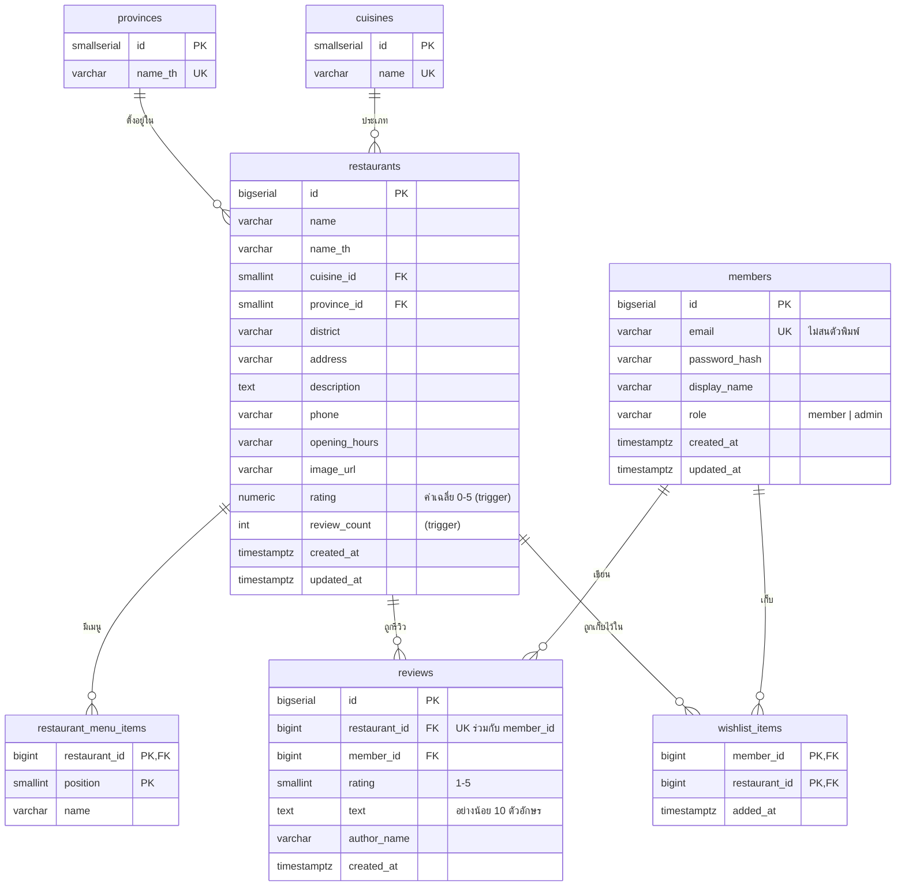

# FoodHub Database Schema (ส่งให้ทีม Go)

| ไฟล์ | ใช้ทำอะไร |
|---|---|
| [`docs/db/schema.sql`](db/schema.sql) | สร้างตารางทั้งหมด (PostgreSQL 14+) พร้อม index, trigger คำนวณคะแนน และ seed จังหวัด 77 จังหวัด + ประเภทอาหาร รันครั้งเดียว |
| [`docs/restaurant-api-spec.md`](restaurant-api-spec.md) | สัญญา API ที่หน้าเว็บเรียก (ชื่อ field แบบ camelCase) |

```bash
psql "$DATABASE_URL" -f docs/db/schema.sql
```

## 1. ภาพรวมตาราง



ผู้ใช้ 3 แบบ (Guest / Member / Admin) ไม่มีตารางของ Guest เพราะ Guest คือคนที่ไม่ได้ login ส่วน Member กับ Admin ใช้ตาราง `members` ตัวเดียวกัน แยกกันด้วยคอลัมน์ `role`

## 2. คำอธิบายแต่ละตาราง

| ตาราง | หน้าที่ | หมายเหตุ |
|---|---|---|
| `provinces` | จังหวัดทั้ง 77 จังหวัด ใช้กรองหน้าเว็บ | seed แล้วใน schema.sql ไม่มีหน้าแก้ไข ฟอร์มหลังบ้านเลือกจาก dropdown ตรงกับค่าคงที่ `PROVINCES` ใน `src/data/data.js` |
| `cuisines` | ประเภทอาหาร (ไทย ญี่ปุ่น ...) | ฟอร์มหลังบ้านพิมพ์ประเภทใหม่ได้ ถ้าชื่อยังไม่มีให้ backend `INSERT ... ON CONFLICT (name) DO NOTHING` แล้วใช้ id นั้น |
| `members` | บัญชีผู้ใช้ | เก็บ `password_hash` (bcrypt) ไม่เก็บรหัสผ่านตรง ๆ อีเมลซ้ำไม่ได้ (ตอบ 409) |
| `restaurants` | ร้านอาหาร | `rating` กับ `review_count` ถูก trigger อัปเดตจาก `reviews` ไม่ต้องให้ Go คำนวณเอง **ไม่มีระดับราคา** (ตัดออกตามดีไซน์ใหม่) |
| `restaurant_menu_items` | เมนูแนะนำของร้าน | ใช้ค้นหาด้วย `q` และโชว์ในหน้ารายละเอียด ลบร้านแล้วเมนูถูกลบตาม |
| `reviews` | รีวิว + คะแนน 1-5 | สมาชิก 1 คนรีวิวร้านเดียวกันได้ 1 ครั้ง (`UNIQUE (member_id, restaurant_id)`) |
| `wishlist_items` | ร้านที่สมาชิกอยากไปกิน | PRIMARY KEY คู่ (member_id, restaurant_id) เพิ่มซ้ำได้โดยไม่ error ลบร้านหรือสมาชิกแล้วรายการหายตาม |

## 3. ความสัมพันธ์กับ API

| API | ตารางที่เกี่ยว | ทำอะไร |
|---|---|---|
| `GET /api/restaurants?q=&province=&cuisine=&sort=&page=&limit=` | restaurants + provinces + cuisines (+ menu items สำหรับ q) | ค้นหา กรองจังหวัด/ประเภท เรียงลำดับ แบ่งหน้า |
| `GET /api/restaurants/{id}` | restaurants + provinces + cuisines + restaurant_menu_items | รายละเอียดร้าน |
| `GET/POST /api/restaurants/{id}/reviews` | reviews | อ่าน/เขียนรีวิว (เขียนต้องเป็น Member) |
| `GET/POST/DELETE /api/wishlist` | wishlist_items | ดู/เพิ่ม/ลบร้านที่อยากไปกิน (ต้องเป็น Member) |
| `/api/admin/*` | ทุกตาราง | จัดการร้าน รีวิว สมาชิก (ต้องเป็น Admin) |

## 4. SQL ตัวอย่างสำหรับ Go

### ค้นหา + กรองจังหวัด + กรองประเภท + เรียงตามคะแนน + แบ่งหน้า

`$1` = คำค้น (หรือ NULL), `$2` = ชื่อจังหวัด (หรือ NULL), `$3` = ชื่อประเภท (หรือ NULL), `$4` = member id (หรือ NULL ถ้าเป็น Guest)

```sql
SELECT r.id, r.name, r.name_th, c.name AS cuisine, p.name_th AS province, r.district, r.address,
       r.rating, r.review_count, r.image_url AS image,
       EXISTS (SELECT 1 FROM wishlist_items w WHERE w.member_id = $4 AND w.restaurant_id = r.id) AS is_wishlisted,
       count(*) OVER () AS total
  FROM restaurants r
  JOIN provinces p ON p.id = r.province_id
  JOIN cuisines  c ON c.id = r.cuisine_id
 WHERE ($1::text IS NULL
        OR r.name ILIKE '%' || $1 || '%' OR r.name_th ILIKE '%' || $1 || '%'
        OR EXISTS (SELECT 1 FROM restaurant_menu_items m
                    WHERE m.restaurant_id = r.id AND m.name ILIKE '%' || $1 || '%'))
   AND ($2::text IS NULL OR p.name_th = $2)
   AND ($3::text IS NULL OR c.name = $3)
 ORDER BY r.rating DESC, r.review_count DESC        -- sort=newest ใช้ r.created_at DESC
 LIMIT $5 OFFSET $6;                                -- limit, (page - 1) * limit
```

### รายการที่อยากไปกิน

```sql
-- เพิ่ม (กดซ้ำได้ ไม่ error) ถ้า restaurant_id ไม่มีจริง FK จะ error ให้ตอบ 404
INSERT INTO wishlist_items (member_id, restaurant_id) VALUES ($1, $2)
ON CONFLICT (member_id, restaurant_id) DO NOTHING;

-- ลบ (ไม่มีในรายการก็ไม่ error ตอบ 204 เหมือนกัน)
DELETE FROM wishlist_items WHERE member_id = $1 AND restaurant_id = $2;

-- ดูรายการ เรียงเพิ่มล่าสุดก่อน
SELECT r.id AS restaurant_id, r.name, r.name_th, c.name AS cuisine, p.name_th AS province, r.address,
       r.rating, r.review_count, r.image_url AS image, w.added_at
  FROM wishlist_items w
  JOIN restaurants r ON r.id = w.restaurant_id
  JOIN provinces p ON p.id = r.province_id
  JOIN cuisines  c ON c.id = r.cuisine_id
 WHERE w.member_id = $1
 ORDER BY w.added_at DESC;
```

### เขียนรีวิว (trigger อัปเดต rating และ review_count ของร้านให้เอง)

```sql
INSERT INTO reviews (restaurant_id, member_id, rating, text, author_name)
VALUES ($1, $2, $3, $4, $5)
RETURNING id, rating, text, author_name, created_at;
-- ชน UNIQUE (member_id, restaurant_id) -> รหัส 23505 ตอบ 409 "คุณรีวิวร้านนี้ไปแล้ว"
```

### ข้อมูลที่ผูกกับร้าน (ใช้ในหน้าลบร้านของ Admin)

```sql
SELECT (SELECT count(*) FROM reviews        WHERE restaurant_id = $1) AS reviews,
       (SELECT count(*) FROM wishlist_items WHERE restaurant_id = $1) AS wishlist;
```

## 5. กติกาที่ฐานข้อมูลบังคับให้ (อย่าเช็กซ้ำผิดข้อความกับ API)

| กติกา | ที่ DB | ข้อความ error ที่ API ตอบ (400) |
|---|---|---|
| คะแนน 1-5 | `CHECK (rating BETWEEN 1 AND 5)` | คะแนนต้องอยู่ระหว่าง 1 ถึง 5 |
| รีวิวยาวอย่างน้อย 10 ตัวอักษร | `CHECK (char_length(btrim(text)) >= 10)` | รีวิวสั้นเกินไป |
| ชื่อผู้รีวิวห้ามว่าง | `CHECK (char_length(btrim(author_name)) >= 1)` | กรุณาใส่ชื่อ |
| อีเมลซ้ำ | `UNIQUE INDEX (lower(email))` | อีเมลนี้ถูกใช้แล้ว (409) |
| รีวิวซ้ำ | `UNIQUE (member_id, restaurant_id)` | คุณรีวิวร้านนี้ไปแล้ว (409) |

ควรเช็กใน Go ก่อนส่งเข้า DB เพื่อให้ตอบข้อความภาษาไทยได้ตรง ส่วน CHECK ใน DB เป็นด่านสุดท้ายกันข้อมูลเสียถ้ามีใครข้าม API
